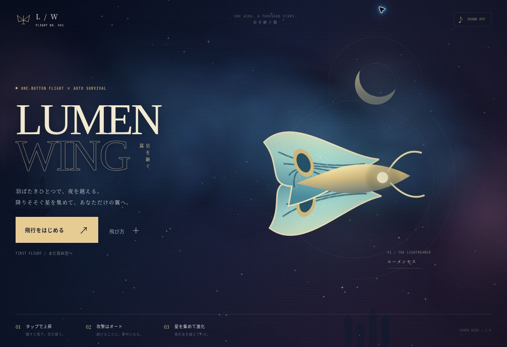

# LUMEN WING — 星を継ぐ翼 / v2.4.0

`yz4git/newgame6` の1ボタン飛行ローグライト。タップで上昇、離すと落下。自動攻撃で敵群を突破し、回収したパーツで次の出撃を強化します。上下どちらにも高度制限がなく、カメラも追従します。

## v2.0

- 6系統の自動兵装：星弾、誘導ミサイル、貫通する荷電ランス、衛星ブレード、連鎖するアーク放電、独立射撃する僚機。
- 9種類の支援強化：威力、装填、弾数、回収、体力、装甲、修復、会心、シールド。3択の成長カードと有限の再抽選で構成を選びます。
- 6つの兵装進化。指定の強化を組み合わせ、エリート母艦が落とす補給箱を拾うと進化。広域爆撃、三連貫通砲、弾消し衛星などへ発展します。条件はハンガーでも確認できます。
- 3機体：ミサイルを初期装備するLANCER、体力と衛星に優れるBASTION、威力と荷電砲に優れるWRAITH。累計60機撃破と90秒生存で追加機体を解放します。
- 終了後にパーツを回収。6種類の恒久強化、5つの達成目標、無料の全額払い戻し、機体選択、即再出撃を追加しました。クリアすると報酬1.4倍の侵攻Ⅱを解放します。
- 敵の密度と耐久を上げ、予告付き突進・狙撃・母艦の増援を追加。2分30秒後の大型艦「星喰い」は3段階で攻撃が激化し、段階移行時に短い装甲バリアを展開します。
- 自機3種と敵5種のメカを新規制作。高精細な透過アートに、噴射、機体の傾き、ハードポイント、砲口閃光、被弾、進化武装を重ねます。虫のモチーフは使用していません。

## v2.4.0 — High-detail Material Scenery

- 以前の単純なSVG図形による安っぽい質感を根本改善するため、写真調の高精細WebPテクスチャ6種を導入。これらは自作ゲーム `yz4git/newgame3` の素材を再利用したもの。
- HELIOSには巨大な軌道造船所、NACREには青緑に色調整した高精細な有機遺跡、PRISMには氷河素材を結晶面に貼り込んだ立体群、EMBERには溶岩の流れる地形、IRONには精密金属パネルの要塞を描画。
- 旧SVG背景の不透明度を下げ、新素材を主役に。遠景/中景の倍率と上下・左右の視差を独立させ、ステージごとの立体感を大幅に向上。
- 障害物の当たり判定・安全な通過帯は維持したまま、6素材目の岩肌画像を含むマテリアルを障害物へ貼り込む。旧障害物はカラーベースの形状のみではなくなる。
- スマホでの起動を妨げない非同期読み込み。HUDの `ART 6/6` は6枚のマテリアルを読み込んだことを表示。画像読込失敗時は従来の描画へ戻る。全素材をSWでオフラインキャッシュ。
- 実機のフレームレートや画質の評価は未実施。写真素材だけに依存せず、動的な光源・粒子・地形を重ねる構成。

## v2.3.0 — High-resolution stage art

- 5ステージ専用の1800×1000 SVGアートを新規制作。人工恒星、生体発光する珊瑚状建築、巨大結晶、溶融製造施設、機械聖堂の各世界に固有の色彩・施設形状・陰影・光源。
- 高精細アートをCanvasのパララックス背景と合成。アートは被弾判定のない背景として配置し、従来の動的構造物と視差スクロールを維持する。機体と敵弾の視認性を優先し合成透明度を調整。
- 追加アートは専用画像を非同期ロードし、ロード失敗時にも従来のCanvas背景で動作。初回ゲーム開始を新しい素材のロードで待たせない。
- 5つのSVGはSelf-contained（CDN・Webフォント不要）。Service Workerのオフラインキャッシュに登録。ランタイムバージョンは2.3.0。

## v2.2.0 — Five Distinct Worlds

- 2分30秒の道中を30秒ずつ5つの異なる宙域へ刷新。「人工恒星の残骸」「星海の珊瑚庭園」「結晶の墓標」「星火の溶鉱炉」「機械聖堂」の背景を専用描画。
- 単なる色替えではなく、人工太陽と軌道施設、生体発光する枝状建造物、透過結晶と屈折光、溶鉱炉と火の粉、機械聖堂と巨大環状構造物を実装。遠景・中景・近景の速度と高度追従を分離。
- ステージ境界では3.8秒のクロスフェード、ステージ名をHUDと進行通知に追加。危険地形も5テーマ別の造形に変更。
- 当たり判定・安全帯予告・1ボタン操作は維持。背景は衝突しない装飾レイヤーで、地形と敵弾を読めるよう明度を抑制。
- 追加画像ダウンロードを必要としないCanvas 2D独自プロシージャルアート。端末負荷を抑えるためランドマークは画面近傍だけを描画。
- グラディウスIIはステージごとの明確なビジュアルアイデンティティの参考のみ。素材・敵・ステージ構造は流用せず独自制作。

## v2.1.0

- Gradius IIを連想させる多層スクロールを強化。宙域が進むと星雲の色、惑星、巨大な要塞・環状施設のシルエットが段階的に変わります。
- 浮遊装甲を大きく立体的に描き直し、発光する割れ目と安全な通過帯の予告を追加。ゲートは上下交互にずれ、無傷で抜けると経験値を獲得し、リザルトにも回避数を表示します。
- 自機を約16%縮小して接触判定も合わせて小さくし、前進速度を約8%上げました。敵群と障害ゲートの間隔もわずかに詰めています。
- iPhone Safariのピンチ・ジェスチャーズームを停止し、縦画面ハンガーの指スクロールは維持します。機体の上下傾きは滑らかに追従します。



## 遊び方

画面タップ、右下の上昇ボタン、Space / ↑ / W で噴射。長押しは約0.23秒間隔で連続噴射します。離すと自然落下し、前進と照準・攻撃は自動です。緑の経験値を集め、レベルアップしたらカードを選択します。カードは1 / 2 / 3、再抽選はRでも操作できます。選択と補給箱の演出中は時間が止まります。

ピンクの敵弾、赤い攻撃予告、浮遊岩、敵との接触を避けてください。35機撃破ごとに修復灯、エリート撃破時に補給箱が出ます。体力が0になると飛行終了。自主撤退でもパーツを持ち帰れます。終了画面には獲得資源、解放、次の目標、使用兵装とダメージ上位が表示されます。

P / Esc またはⅡで一時停止。タブを離れても停止します。サウンドは初期OFFで、♪から変更できます。短い合成効果音を使用しています。スマートフォンの縦横表示とセーフエリアに対応しています。

進行は同じブラウザーのローカルストレージに保存されます。v1の記録と音設定を移行し、既存の撃破・生存記録による機体解放も反映します。端末間の同期はありません。保存拒否や破損時も起動しますが、保存できない場合はハンガーに案内を表示します。

## 開発

ランタイム依存パッケージ・ビルド工程・外部CDNは不要です。`dist/` が静的配信対象です。

```sh
npm test
npm run check
node scripts/balance.mjs
```

- `dist/catalog.mjs`：機体、兵装、進化レシピ、恒久強化、達成目標。
- `dist/model.mjs`：決定的乱数、120Hz物理、全自動戦闘、成長、補給、敵の予告とボス。
- `dist/render.mjs`：Canvas 2D、アート読込、噴射・砲口・弾幕、障害物。
- `dist/stage-art.mjs`：5宙域の固有パララックス背景、ランドマーク、空間光、クロスフェード。
- `dist/touch.mjs`：iOSのピンチ・ダブルタップズーム抑止とページ原点復帰。
- `dist/app.mjs`：入力、時間ステップ、画面遷移、ハンガー、結果と報酬。
- `dist/storage.mjs`：保存移行、報酬の重複防止、購入、全額返還、機体解放。
- `dist/audio.mjs`：外部音源を使用しないWeb Audio効果音。
- `dist/assets/mech-atlas-v2.*`：透過WebPと8機体の切り出し座標。
- `dist/sw.js`：全モジュールとアートを含むオフラインキャッシュ。

Managed preview は `sites-preview start /workspace/sites/nocturne-eclipse`。実行前にSitesのプレビュー手順を確認してください。

## 検証

追加ステージアートの描画スタブテストに加え、従来の23件のテストで飛行と上下スクロール、全兵装、進化6種、予告の再発動、障害ゲートの交互配置と回避報酬、装甲・シールド・再起動、成長と補給の同時取得、保存移行、購入上限と返還額、報酬の重複防止、縦画面のオブジェクト上限、縦横のキャンペーン装備でのクリア経路、傾きの平滑化、ピンチ・ジェスチャーズーム抑止と1本指タップ・スクロールを確認します。クリア試験は正規の最大恒久強化から開始し、実際の成長選択と補給を経由します。飛行中の体力書き換えは使用しません。

`scripts/balance.mjs` は未強化と最大恒久強化の出撃を各3シード・縦横で比較します。一定間隔の入力を使ったシミュレーションであり、人による到達時間や実機性能の測定ではありません。

画面確認用の一時ファイルは `node scripts/prepare-qa.mjs` で作成できます。`/_qa-phone.html` の844×390 / 390×844のiframeで、通常のアプリに明示的な戦闘・成長・進化・ボス・結果の状態を読み込みます。これらは通常プレイによる到達記録ではありません。

配信前に `node scripts/clean-qa.mjs` を実行してください。`npm run check` はQAファイルの残存、JavaScript構文、DOM参照、8機体の矩形、manifest、オフライン依存を検証します。画面確認と制限事項は [v2.0検証記録](docs/qa-v2.0.md) に記載しています。実機iPhoneの性能・タッチ・ホーム画面追加・オフライン動作は未検証です。

## アートと配信

新しい機体アートは画像生成で制作した独自素材です。生成指示は `art-prompts-v2.json` に記録しています。8機体を1枚の透過WebPにまとめ、機体本体の描画にゲーム側のアニメーションを接続しています。画像の絵柄自体がフレーム単位で変形するスプライトアニメーションではありません。背景・エフェクト・UIはCanvas / CSS / SVGです。

既存のSitesプロジェクトと閲覧範囲を維持して反映します。`.openai/hosting.json` のIDを変更しないでください。旧バージョンはGit履歴に残ります。
