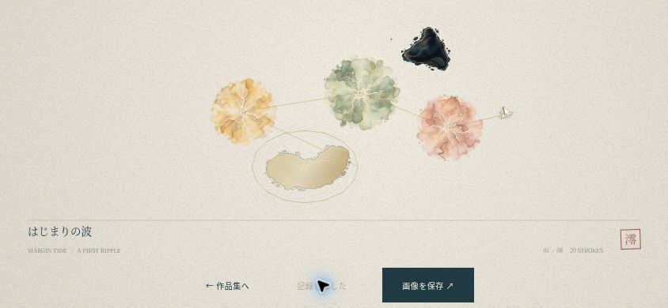
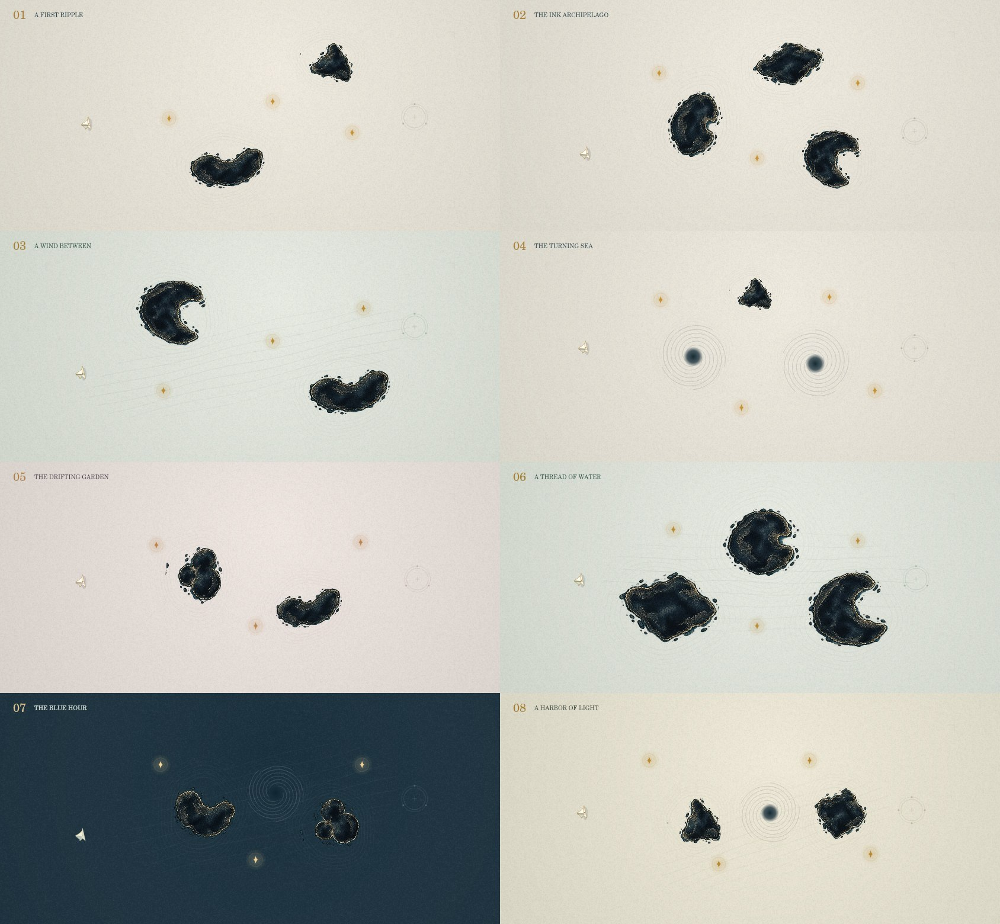

# 余白航路 — MARGIN TIDE

墨の島、紙の舟。指で引いて放すたび、あなただけの航路が生まれる、小さなアートゲームです。

[▶ 海へ出る](https://nocturne-eclipse.yzgame.chatgpt.site)

**yz4git/newgame6を、新しいゲームとしてゼロから制作しました。** 前作の戦闘・人物・背景・音・UIは使用していません。参考画像から取り入れたのは、余白、紙と顔料の質感、少ない要素で強い個性をつくる方向性です。画像内の場面や10種類の仕掛けは再現していません。

## v1.1 — 紙が、航海を覚えている

- 灯を集めると、金・朱・青磁・藍の顔料が和紙へゆっくりにじみます。海ごとに色の組み合わせも変わります。
- 墨の島の近くをぐるりと一周すると、金箔と細い継ぎ目のある島へ変化。金継ぎした島は通り抜けられ、新しい航路になります。往復運動や島の移動だけでは金継ぎは起きません。
- 舟の速さで金の航跡の太さが変わります。長く遊んだ航路も、線の切れ目を保って圧縮・保存します。
- クリアした航路を作品集へ自動記録。航海の途中でも、一時停止の「航路を眺める」から記録できます。
- 「作品にする」でHUDを外し、余白・題名・落款を添えた一枚に。1800×1000のPNGとして保存できます。iPhone向けに画像の長押し保存と、対応環境での共有も用意しています。
- v1.0の航海帖と設定は引き継ぎます。過去の進行から航跡を推測して作品を捏造せず、これから記録した航海を作品集に残します。



[更新の実装・確認記録](docs/qa-v1.1.md) / [ゲームが書き出した作品例](docs/paper-print-v11.jpg)

## 遊び方

1. 画面のどこからでも、進みたい方向と逆へ引いて放します。
2. 長く引くほど遠くへ。狙っている間は時間がゆっくりになります。航海の途中でも狙い直せます。
3. すべての灯を集め、ひらいた港の輪へ入るとクリア。

墨に触れると直前の安全な場所へ戻ります。灯は失わず、回数や時間の制限もありません。海図の端は柔らかく跳ね返ります。

少ない漕ぎ数・墨に触れない渡航で、航海帖にしるしが残ります。8つの海は好きな順に選べます。風に運ばれる海、回り込む渦、漂う島、夜の海など、それぞれ航路の取り方が変わります。

| 海 | 名前 | 特徴 |
| --- | --- | --- |
| 01 | はじまりの波 | 引いて放す、4漕ぎの旅 |
| 02 | 墨の群島 | 島の間を抜ける航路 |
| 03 | 風の通り道 | 流れに乗って遠くへ |
| 04 | めぐりあう渦 | 渦の縁を利用する |
| 05 | 漂う庭 | 動く島を見て帆を張る |
| 06 | ひとすじの水路 | 短い漕ぎを重ねる |
| 07 | 青い余白 | 青い紙に浮かぶ灯 |
| 08 | 帰りの灯 | 4つの灯を運ぶ最後の海 |



## スマートフォン

iPhone Safariの横画面を中心に設計しています。縦画面では海図を90度回して表示し、操作方向も合わせて変換します。画面端の余白、Pointer Events、指を離したとき・画面を切り替えたときの解除に対応しています。

最初の操作で音声を開始します。一時停止から音楽・効果音と水面のゆらぎを切り替えられます。Safariの共有からホーム画面へ追加できます。初回のオンライン読み込み後、必要なファイルをService Workerがまとめて保持します。

キーボードでは方向キー / WASDで狙い、Spaceで漕ぎます。Escapeで一時停止、Rでやり直し。

## 保存

航海帖・海ごとの作品・進む海・音とゆらぎの設定は、この端末と配信元のブラウザーに保存されます。作品集は各海の最後の一枚を保持します。航海中の途中位置は再読み込みで海の出発点に戻ります。前作とは保存キーを分けています。保存が使えない環境でも遊べ、保存失敗を画面で知らせます。

## 構成

ビルド・実行用パッケージ・外部CDN・アカウント登録・サーバー保存は不要です。`dist/`を静的配信します。ルートの`index.html`は`dist/`へ案内します。ChatGPT Sitesは既存の配信先とアクセス範囲を維持しています。

- `dist/model.mjs`: 120Hzの舟・抵抗・流れ・渦・衝突・復帰・収集・到着。
- `dist/levels.mjs`: 8つの手作りの海と配色。
- `dist/render.mjs`: 紙の繊維、墨の島、等高線、水面、予測航路、紙の舟、航跡。
- `dist/app.mjs` / `dist/ink.css`: 指操作、縦横の表示、航海帖、設定、結果画面。
- `dist/audio.mjs`: Web Audioで作る柔らかな旋律と灯の音。
- `dist/prints.mjs`: 航跡の圧縮、作品の検証と復元。
- `dist/storage.mjs` / `dist/sw.js`: 記録と完全なオフライン用ファイル群。

## 美術

墨の島のアトラスは**組み込みimage_gen**で専用に生成しました。採用素材は`dist/assets/ink-atlas.webp`、最終プロンプトは`art-prompts.json`です。透過を保ったWebPへ圧縮して組み込んでいます。v1.1の顔料も組み込みimage_genで新規生成し、`dist/assets/pigments.webp`へ保存。最終プロンプトは`art-prompts-v11.json`、2×2のアトラスとして使用しています。

紙の粒子と繊維、金の等高線と航跡、折り紙の舟、灯・渦・水面はCanvasで描画・アニメーションします。独立した人物のコマを切り替える方式を使わず、舟の向きと帆が連続的に動きます。

## 確認

```sh
npm test
npm run check
```

自動検証は、4漕ぎでの初回クリア、取得済みの灯を保つ復帰、連続した引き直し、予測と衝突の一致、全8海の灯・港への通路、縦横と画面端の座標変換、保存の破損・利用不可、配信とオフライン用の依存関係を対象にしています。

初版のブラウザー確認は[docs/qa.md](docs/qa.md)、v1.1は[docs/qa-v1.1.md](docs/qa-v1.1.md)。iPhone実機の性能・マルチタッチ・音声・オフライン起動は未計測です。

`tests/phone.html`は844×390 / 390×844と画面端の余白を切り替える開発用の確認枠です。配信には含めません。`scripts/render-seas.mjs`は任意の美術レビュー用で、実行には`@napi-rs/canvas`を使用します。ゲーム本体には追加の依存はありません。
