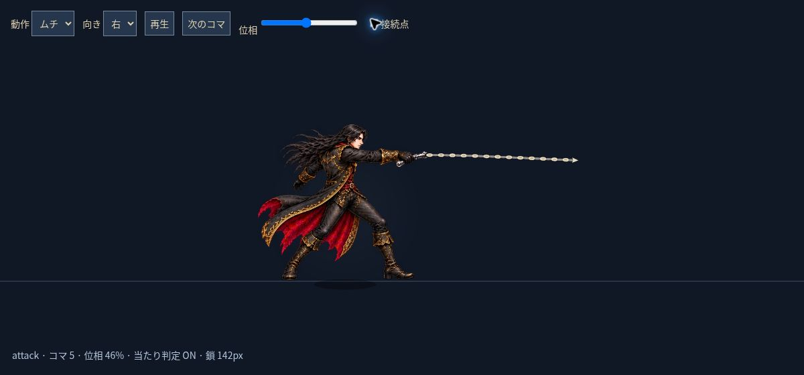

# v2.2 キャラクターと鞭のアニメーション修正

コマごとに原画の体格・余白・接地位置が異なるのに、同じ倍率と切り出し下端で描いていたため、姿勢を切り替えると体が伸縮・移動していました。鞭は絵の手と無関係な固定座標から出ており、光の曲線の長さと命中範囲も一致していませんでした。

## 実装

攻撃専用の8コマを作成し、構え・引き・頭上への振り上げ・振り出し・伸展・余勢・戻し・構え直しを順に再生します。各コマに足の基準点と握り位置を計測して設定しました。走行は体高を150px前後へ統一し、跳躍も同じ体格に調整。待機は一つの整った姿勢の微かな呼吸で表現し、異なる絵を往復させるちらつきを解消しました。

`pose-data.mjs` に原画の切り出し座標・基準点・倍率、`animation.mjs` に姿勢と手の座標変換を集約しています。腕が隣のセルへはみ出す部分は複数のソース矩形を組み合わせて、隣の人物を混ぜずに元の絵を描画します。着地時の圧縮も足の位置を固定して行います。

鞭の始点は、その瞬間に表示している絵の握り位置です。鎖は26区間へ等距離で分割し、構え・振り出し・戻しの全体で長さを一定に保持。金属リンクと小さな終端を描き、先端の発光球は除去しました。左右反転は人物と同じ座標変換を使います。

攻撃の40〜64%でのみ、表示に使う腕と鎖の線分を敵・燭台と接触判定します。三連撃・月銀の鎖による射程差、1振り1回のダメージ、回避キャンセルは維持しています。地上攻撃と詠唱は短く減速して足を止め、空中攻撃では横移動できます。

敵にも体の基準点を設定しました。コウモリの羽や亡霊の裾の形で体の位置が飛ばなくなり、騎士は実際に移動しているときだけ歩行コマを使います。被弾の明滅と回避の残像も通常描画と同じ基準点を使います。

## 確認

- `npm test`: 26項目すべて成功。全8コマ・左右の握り接続、全位相の鎖長、床への貫通、振りかぶり・戻し中の非命中、実際の軌道での命中、走行の体高と接地、地上の足滑り、空中の移動、回避キャンセルを含みます。
- `npm run check`: JavaScript、UI参照、画像、アトラス境界の検証に成功。
- クラウドブラウザーで攻撃の伸展と振りかぶりを左右それぞれコマ送り確認。走行の足位置も確認。
- 844×390の実ゲームで三連撃、移動＋攻撃、二段ジャンプ＋攻撃を入力し、敵と燭台への命中、操作後の描画継続を確認。アプリ由来の警告・例外はありません。
- iPhone実機のフレームレート・マルチタッチは未計測です。

[8コマの描画確認](animation-v22-frames.png) / [アニメーション確認動画](animation-v22-preview.mp4)

動画とコマ一覧は `scripts/render-animation-preview.mjs` がゲーム本体のモデルとRendererで生成した確認用描画です。実機プレイの録画ではありません。任意の確認ツールには `@napi-rs/canvas`、MP4化にはffmpegを使用しました。配信ゲームの依存パッケージは増えていません。

## 素材

組み込みimagegenで透過の攻撃アトラスを生成しました。採用原画を `dist/assets/attack.webp` として透過WebPへ変換し、アトラス登録で組み込みました。依頼文は `art-prompts-v22.json` に保存しています。背景や既存美術に、他ゲームの素材は使用していません。

開発用の `tests/animation-preview.html` と `tests/qa-input.js` は配信に含めません。
