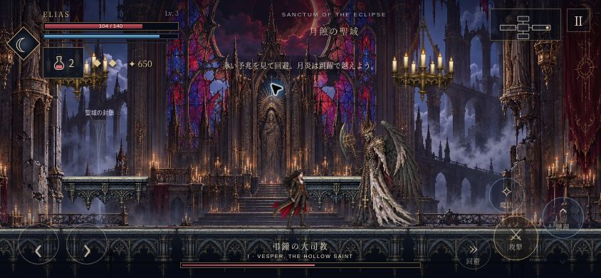
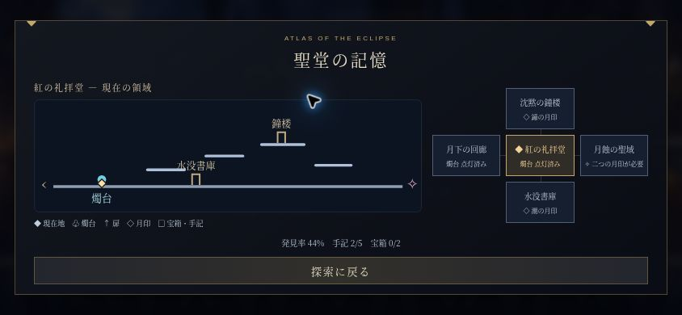

# v2.1 実画面プレイレビューと修正

クラウドブラウザーの844×390横画面で、開始・移動・最初の剣士との戦闘・被弾・回復・回避・魔法・ボス戦・地図・設定・保存を確認しました。確認には実際のゲーム入力を使い、領域別の確認には専用の検証用セーブも使用しています。iPhone実機での性能・音声・実際のマルチタッチは未計測です。

| 優先度 | 問題と確認方法 | 修正 |
| --- | --- | --- |
| 最優先 | 礼拝堂・Lv.3・650ソウルの記録でタイトル→設定→再読み込み。初版では回廊・Lv.1へ戻った。未開始のプレビューモデルを `pagehide` が保存していた。 | 開始した旅だけを保存する `JourneySession` を導入。同じ手順を繰り返して礼拝堂・Lv.3が維持されることを確認。設定に前回バックアップの復元と内容確認を追加。 |
| 高 | 回避終了後にも速度が残り、無入力で約280px進んで間合いを通り過ぎる。回避や魔法の短い入力も不許可期間に消えていた。 | 回避終了時に余分な速度を除去。無入力時の移動量は約178px。短い先行入力を保持し、攻撃中から入力方向へ回避できるよう変更。ボス戦で魔法の発動・MP消費・命中を確認。 |
| 高 | ボス部屋の左境界が見えない。弾が小さく、予兆の `!` が背景に埋もれやすい。 | 霧の封鎖と地図上の境界、明るい菱形の敵弾、背景付きの予兆と発動までの表示を追加。第二段階移行中の結界も表示。 |
| 中 | 地図は五つの領域の接続だけで、今いる足場・扉の位置を判断できない。 | 現在地、足場、燭台、扉、未収集品の詳細地図を追加。横画面で閉じるボタンまで収まることを確認。 |
| 中 | 開始直後の目的・通知・操作ヒントが近い位置に出る。回復薬のタッチ範囲も小さい。 | ヒントと通知の同時表示を避け、冗長な開始通知を削除。回復薬を識別できる図柄と58×44px以上の操作範囲に変更。実画面で104→140、薬2個への更新を確認。 |
| 中 | 左へ戻る場合もプレイヤーが画面左側に寄り、進行方向が見渡しにくい。 | 向きに合わせてカメラの寄せ方を滑らかに変更。回避中の過剰な先読みも制限。 |
| 高 | 新しいHTMLだけを旧キャッシュへ保存すると、更新が中断された際にオフラインの依存関係が揃わない可能性があった（コード確認）。 | オフライン用HTMLをリリース単位で固定。全ファイルの事前キャッシュ完了後に新しい版を有効化。オンライン応答が旧シェルを上書きしない回帰検証を追加。 |

## 再確認

- 設定を開いた状態の再読み込みでも、開始前の記録を維持。
- バックアップの場所・レベル・月印・ソウルを確認し、復元を取り消せる。
- 最初の剣士を通常入力の連撃で撃破。被弾と討伐後の回復・ソウル加算を確認。
- ボス戦で回避、魔法の命中、MP消費、回復薬、予兆と封鎖の描画を確認。
- 詳細地図を横画面で確認。アプリ由来の実行エラーなし。
- `npm test`: 21項目通過。移動と全足場ルート、戦闘、守り人、ボス各段階、保存、先行入力、回避距離、オフライン依存関係を検証。
- `npm run check`: JavaScript、UI参照、素材、アトラスの範囲を確認。

## 画面

## 検証用UI

`tests/qa-mobile.html` を `dist/_qa-mobile.html`、`tests/qa-input.js` を `dist/_qa-input.js` に一時コピーすると、横画面フレームと、ゲームのキーボード入力を一定時間保持する検証用ボタンを使えます。検証後は二つの一時ファイルを取り除いてください。公開用 `dist/` には含めていません。

## 残る確認範囲

iPhone実機の長時間プレイ、Safariでのホーム画面起動・オフライン起動・マルチタッチ・音声、実ゲームパッドは未確認です。短い五領域の構成や、フレーム数に制限のある動きは継続して磨けます。本レビューは操作・視認性・保存の具体的な問題を優先した修正で、商用作品と同等の全項目を保証するものではありません。
