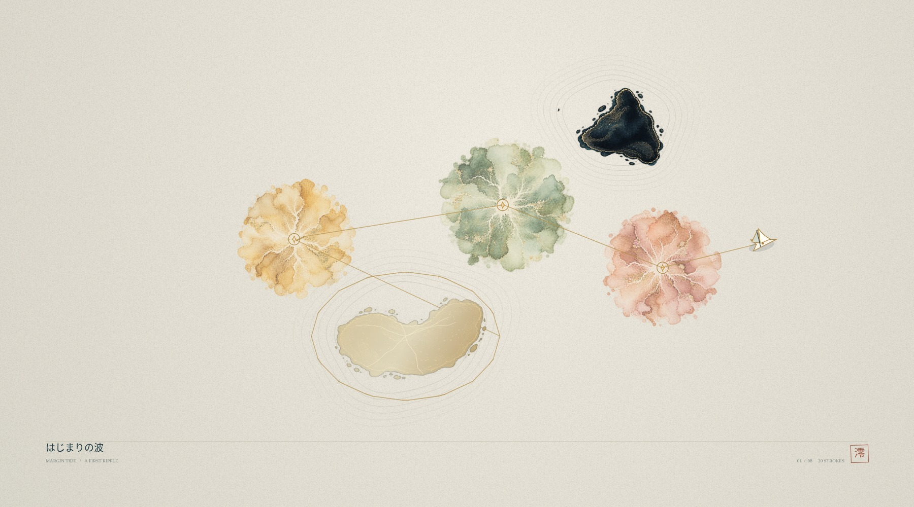

# v1.1 — The Living Paper

## アートが遊びを変える更新

灯は回収済みのチェック印だけでなく、和紙に染み込む顔料になります。色は海の配色に合わせ、金・朱・青磁・藍を組み合わせています。透過アトラスの粒状感と白い毛細管のようなにじみを、紙の繊維に重ねて描画します。

墨の島を一周して航路を結ぶと、島が金継ぎされます。暗い顔料が金箔色へ変わり、島の透過輪郭に沿って細い継ぎ目が現れます。金継ぎした島は衝突を失い、舟で横切れるようになります。表示と予測航路・衝突判定は、同じ金継ぎ状態を使用しています。

判定は舟の移動に伴う島の周りの角度と距離を追跡します。島自体の移動、単なる往復、転落・復帰の座標飛びは一周に数えません。金継ぎ済みの島は、その後に墨へ触れても元に戻りません。従来の灯を集めて港へ行くクリア条件は維持し、金継ぎは寄り道と新しい航路を作る任意の遊びです。

航跡は速度で線幅を変え、淡い芯と疎らな金箔のしるしを重ねます。画面用の航跡は追加分だけ描き足すキャンバスに保持し、毎フレーム全区間を描き直す負荷を抑えています。

## 自分の航路を一枚にする

航海の終了時、または一時停止の「航路を眺める」から、HUDを外した紙面として鑑賞できます。題名、海の英名、漕ぎ数、落款を添えます。縦画面では海図の向きも縦に変わります。

作品集は海ごとの最新の一枚を保存します。灯の位置と色、金継ぎした島、航跡とその切れ目、舟の位置と向き、動く島の時刻を保持します。長い航跡は形を保って間引き、復帰前後の線を勝手につなぎません。途中の作品を記録しても、クリア記録は付与しません。

「画像を保存」で1800×1000のPNGを生成し、プレビューから明示的に保存します。対応する環境には共有ボタンを表示し、iPhone向けには画像を長押しして保存する手段も残しています。

## 確認

`npm test`: 15項目。既存の4漕ぎでの初回クリア・復帰・経路・座標・保存・オフライン依存関係に加え、以下を検証しました。

- 16回の実際のlaunchと120Hz更新で島を一周し、金継ぎが1回だけ発生する。
- 金継ぎした島を予測線と舟が通り抜け、その後の転落でも状態を保持する。
- 往復や動く島だけでは金継ぎが発生しない。
- 作品の復元で顔料・金継ぎ・航跡の太さ・線の切れ目を保持する。
- 長い航路を圧縮しても始点・終点と別々の線を保つ。
- v1.0の記録と設定を引き継ぎ、途中の作品の保存でクリア扱いにしない。

`npm run check`: モジュール構文、UI参照、2種類の美術アトラス、PWAの素材を確認。

クラウドブラウザーでは次を確認しました。

- 既存のv1.0セーブから、航海記録を保持して空の作品集へ移行。
- 実モデルで生成した金継ぎの航路を作品集で復元し、サムネイル・顔料・金継ぎ・航跡を表示。
- 844×390と390×844で鑑賞・記録・戻る・保存ボタンを表示。記録ボタンが成功表示へ変わることを確認。
- 保存用プレビューを開き、通常のトップレベル画面から実際のPNGを取得。ファイル形式と1800×1000の寸法、画像の内容を確認。
- 最終画面でアプリ由来のJavaScript例外・警告なし。

作品例の航路は、開発用画面の「金継ぎの航路を生成」で実モデルへ16回の一周操作と4回の回収・到着操作を与えて作ったものです。人がブラウザーで一周を手操作した記録ではありません。開発用の確認枠は配信から除外します。

ブラウザー確認は画面サイズを合わせたもので、iPhone実機のフレームレート・指の操作・長押し保存・共有シート・オフライン起動は未計測です。

## 新規素材

組み込みimage_genで顔料の透過アトラスを生成しました。採用素材は `dist/assets/pigments.webp`、元画像1254×1254、2列×2行、1セル627px。プロンプトは `art-prompts-v11.json` に収録。紙面、継ぎ目、金の航跡、印刷レイアウトはゲーム内で描画します。
