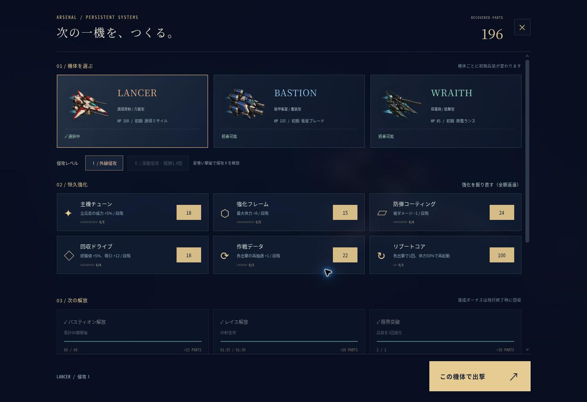

# Lumen Wing v2.1.0 検証記録

2026-10-26。対象はv2.1.0の宙域背景、回避ゲート、自機縮小、テンポ調整と、直前版のiPhone Safari拡大抑止・機体姿勢の改善です。

## 自動テスト

`npm test`：23件成功。入力後の上昇、自然落下、上下カメラ、自機の縮小判定と約8%の前進速度増、上昇・下降時の滑らかな傾き、交互に上下する障害ゲート、無傷通過の経験値報酬と接触時の報酬取消を確認しました。成長中の停止、オート射撃、ミサイル範囲攻撃、ビーム貫通、僚機・衛星・連鎖雷撃、シールド再装填と1回限定再起動も含みます。

補給箱による6種の進化、XPと補給の同時取得、敵の攻撃予告の繰り返し、ボスの高度追従と段階変化、記録移行、保存拒否・破損、購入上限、全額返還、リロードをまたぐ報酬重複防止も含みます。

90秒の縦画面シミュレーションで数値とオブジェクト数の上限を検証しました。キャンペーン装備の通し試験は正規の最大恒久強化を装備したBASTIONで開始し、実際の3択と補給箱を処理して縦横でボスを撃破しました。飛行中の体力やダメージを書き換える試験ではありません。タッチガードのユニットテストではSafariのgestureイベント、二本指タッチ、Ctrl/Meta+ホイールを止め、1本指のタップ・移動イベントを通すことを確認しました。

## 難易度比較

`node scripts/balance.mjs`、シード17 / 104 / 302、一定間隔の噴射、同じカード選択方針で比較しました。

| 開始装備 | 1100×640 | 390×840 |
| --- | --- | --- |
| 未強化LANCER | 35〜40秒で終了、79〜98撃破 | 28〜44秒で終了、62〜127撃破 |
| 最大恒久強化BASTION | 158〜162秒で撃破、進化1〜2種 | 155〜156秒で撃破、進化1〜2種 |

この比較は指定入力とシードによる回帰確認です。人間のプレイの平均難易度や全構成のクリア保証ではありません。未強化からの成長余地と、正規の強化後に突破できる経路を確認する目的です。

## ブラウザー画面確認

Managed preview の本番入口と、同じアプリを読み込む一時QA画面で確認しました。844×390の横画面と390×844の縦画面で、火山・機械・終端の各宙域、障害ゲートと自機の大きさを確認しました。

- 高精細な機体アート8種を読み込み、タイトル、機体3択、敵群と大型艦を表示。読み込みに関するアプリの警告・エラーはありませんでした。
- 通常入口から出撃し、Space入力による上昇とカメラ追従、攻撃入力なしでの撃破、停止、撤退、回収、ハンガーへの遷移を確認しました。
- 進化の明示的QA状態からラグナロク斉射の報酬表示と続行を確認。成長画面の再抽選で残り回数2→1、カード更新を確認しました。
- 終了のQA状態から130パーツと2機体解放を表示。18＋15パーツの購入後97、リロード後97を確認。無料払い戻しで130に戻りました。
- WRAITH選択後に初期ビーム・HP85・威力116%で出撃することを確認しました。
- 縦画面ハンガーはスクロール領域652px / 内容1828px。実際のスクロールでscrollTop 0→936へ移動し、目標と進化図を表示。下部の出撃ボタンは固定表示を維持しました。
- ゲーム入口のviewportでminimum/maximum scale=1とuser-scalable=noを確認。ブラウザー上でも縦画面body=`manipulation`、ゲームcanvas/上昇ボタン=`none`、ハンガー=`pan-y`の適用を確認しました。
- 横画面の結果表示は2列で収まり、資源・機体解放・次の目標・再出撃が見えます。
- 飛行時間40秒ごとに背景が青い軌道遺跡→赤い火山岩壁→青緑の環状機械群→紫の終端要塞へ移行することを確認しました。各宙域は背景の色、巨大構造、星雲が異なります。
- 障害ゲートは交互に上下の通過帯を変え、輪郭とゲート帯を背景から区別できます。portraitでは約16%小さい機体と狭めた通路が同時に表示され、HUDと上昇操作に重なりません。

QA状態には任意の時刻・レベル・敵配置・記録を使用しています。画像や解放確認は通常プレイでその状態に到達した証明ではありません。QAファイルは配信対象から除外します。

## 修正して再検証した点

- 敵の予告タイマーが負値になった後も、次の突進・射撃を予告できるようにリセット。
- シールドが被弾直後に再生成される問題を修正し、実際の再装填時間を設定。
- 終了した同じ更新中の追加攻撃で、死亡とクリアが重ならないように防止。
- 成長と補給の同時取得で、片方の報酬を失わないように待ち行列を追加。
- 新しい機体アートの砲口に合わせ、星弾とビームの発射位置と閃光を接続。
- 全モジュールとアートをv2キャッシュに更新し、古いモジュールとの混在を防止。
- viewport拡大率を固定し、Safariのgesture・多点タッチ・Ctrl/Meta+ホイールのズームを抑止。1本指の操作を止めない。
- 機体の傾きを垂直速度から短い平滑化で作り、上昇時−8度・下降時+9度に制限。発射位置も機体と同じ角度へ合わせ、エンジン光の揺れを緩やかにする。
- 背景の宙域選択を演出タイマーからミッション時間へ接続。実際の飛行経過で4つのパレットと背景セットが切り替わる。
- 岩塊をファセット・発光亀裂・内側の警告灯つきに描き直し、背景とは補色の警告色を使う。通過帯は交互に上下へ移動し、無傷で抜ければ経験値2と回避数を与える。
- 実戦機体を0.84倍、接触半径を12.5に統一。前進速度を約8%、敵群とゲート頻度を少し上げる。

## 配信前確認と制限

`npm run check` でJavaScript構文、DOM ID、8機体の矩形、WebP形式、manifest、全オフライン依存、QAファイル除外を検証しました。クラウドブラウザーでは実機のiOSピンチ操作自体は発生させられず、Safari用イベントのユニットテストと端末寸法の表示確認で検証しました。実機iPhoneのSafari性能、ホーム画面追加、サービスワーカーによるオフライン利用、音の聴感も今回の確認には含めていません。

保存はブラウザー単位で、端末間同期はありません。旧記録を移行し、記録破損や保存拒否でも起動可能にしています。

