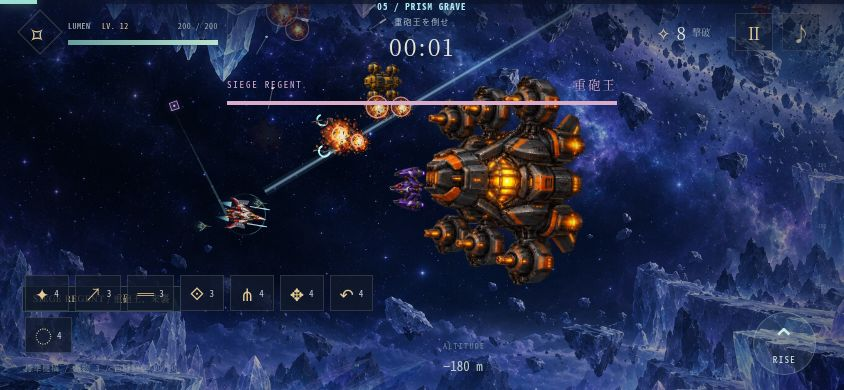

# LUMENWING v4.1 — 実画面プレイチェックと改善

2026-10-26。公開版v4.0を通常出撃で操作し、その後ローカルの修正版を844×390・390×844のブラウザー画面で確認した。実機iPhoneでの検証ではない。

## レビューと対応

| 確認した問題 | 修正 |
| --- | --- |
| 縦に大きく移動すると経験値が上方に取り残され、撃破後も成長を待つ | 2.2秒後や画面外に離れた経験値が自動追従。回収速度を上げ、下降中にも追いつけるようにした |
| 下降し続けると有限の障害物の下を抜けてしまう | 遠征の地形を上下につながる壁へ変更。表示範囲と接触範囲だけをタイル化し、当たり判定にも同じ素材輪郭を使用 |
| 通路の高度が画面外へ移動すると戻る方向が分かりにくい | 次の通路のマーカーと、画面上端・下端での方向案内を追加 |
| 画面外の狙撃艇などが射撃を始める | 射撃・突進の予告は画面内で開始し、画面外では新しい弾を発射しない |
| 恒星など明るい背景で敵弾や予告が埋もれる | プレイ中の背景を控えめに暗くし、敵弾を暗い外縁・ピンクの輪郭・白い芯で描画。予告線を太くした |
| 通知が前方の飛行空間を覆う | 小さい通知を左下のHUD付近へ移動。被ダメージは機体近くに数値表示 |
| 新型敵に被弾フラッシュがなく、一方で従来の点滅は白く強すぎる | 追加アトラスにも被弾用素材を生成し、白い重ね描きを抑制 |
| 縦画面でボスが右端に欠け、追従中には自機へ寄りすぎる | 画面幅に応じてボスと接触半径を調整。機体の前進速度を加味して予定した間合いを保つ。回転時も再配置 |
| 重砲王でもHP欄が「星喰い」、ボス戦時計が2:30から始まる | ボス種別に対応する名称へ更新し、ボス戦の経過時間を0:00から表示 |
| 地形の端を抜け切る前に回避報酬が出る可能性 | 最も広い地形と自機の半径を含む出口を越えてから精算 |

## 実操作の範囲

- 公開版v4.0の通常出撃で、上昇・下降、敵の接近、撃破・回収、最初の地形を確認。
- 修正版の通常出撃からレベル2の3択まで進み、フラック散弾砲を選択して飛行を再開。
- 地形専用の開始位置から連続する壁を操作し、通路案内、シールドと接触ダメージを確認。手動でキャンペーン全体をクリアしたわけではない。
- ボス専用シナリオを横・縦で操作し、見切れ、追従間隔、名称、時計、通知位置、被弾時の見え方を再確認。画像は描画確認用の装備を使用した検証シナリオ。

## 自動検証

`npm test`: 46件成功。新しい回帰チェックは、遠くの高度でも地形に隙間がないこと、タイル生成数が増え続けないこと、回避報酬の出口、画面外からの射撃防止、下降中の経験値回収、縦画面と回転後・追従中のボスの収まりを対象とする。

既存の3ボスパターン×横縦キャンペーン検証も通過。遠征の検証操作は、壁を下から迂回する従来の一定周期入力から、次の通路へ高度を合わせる操作に変更した。

`npm run check` と `git diff --check` で構文、UI参照、オフライン素材、梱包状態を確認。QA専用HTML・操作ブリッジは公開物から除外した。
