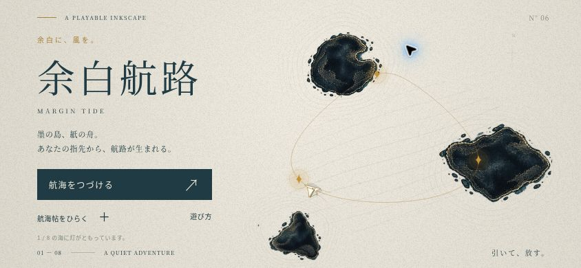
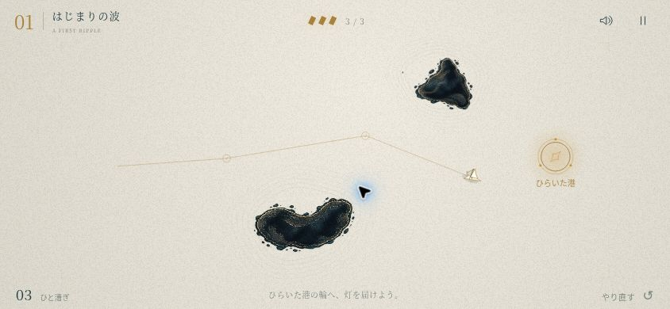
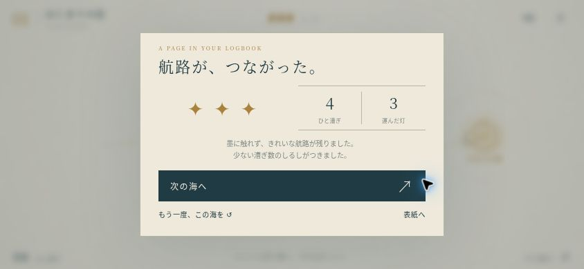

# 余白航路 v1.0 — 制作・確認記録

## 新しいゲームとしての設計

横スクロールの戦闘ゲームを置き換え、操作も視点も美術も新しい作品にしました。プレイヤーは人型のキャラクターではなく、紙を折った小さな舟です。後ろへ引いて放すと滑走し、航路が細い金の線として海図に残ります。

参考画像からは「余白」「触れられそうな画材」「少ない形の組み合わせで個性を出す」方針を取り入れました。影の足場・音の地形・白黒反転・残像・額縁などの場面やゲームの仕掛けは使っていません。

墨の島は新規生成した透過の顔料アトラスです。舟、水の等高線、流れ、渦、灯、金の航跡、紙の粒子と繊維はゲームコードで描きます。帆と船体の向きは連続的に動きます。音楽・効果音も新しくWeb Audioで作っています。

## ブラウザーでの操作確認

クラウドブラウザーの実際のポインター入力で確認しました。スマートフォンの画面サイズは同一配信元のiframeで設定しています。

- 1363×936で表紙・海の描画を確認。
- 844×390で最初の海を2回プレイ。4回のドラッグとリリースで3つの灯を集め、港を開いてクリア。取得数・航跡・漕ぎ数・3つのしるしを確認。
- クリア後に次の海へ移動。再読み込み後、最初の海の記録と進む海が保存されていることを確認。
- 一時停止・再開、音とゆらぎの切り替え、航海帖から別の海を選ぶ操作を確認。
- iPhone横画面相当の左右44px・下21pxの余白を付け、HUDと海図が端に重ならないことを確認。
- 390×844で海図の縦表示を確認。青い余白の海でドラッグし、狙った方向へ移動して最初の灯を取得。
- 最終版の結果画面は横画面内に全体が収まり、次の海・やり直し・表紙へのボタンが表示されます。
- 最終確認時、アプリ由来の警告・JavaScript例外はありません。

## 自動検証

`npm test` の10項目と `npm run check` を実施します。

- 実シミュレーションを使った4漕ぎでの初回クリア。
- 墨との衝突と安全な場所への復帰、取得済みの灯の保持。
- 狙いの強さ、無効な入力、海図端の反射、素早い狙い直し。
- 予測線と実際の衝突位置の一致。
- 全8海で、時刻0・6・14秒の実際の衝突形状を避けて、すべての灯と港へ通れる経路があること。
- 縦・横・iPhone相当の余白を含めた、画面と海図の座標変換。
- 航海帖の最良記録、前作の保存との分離、破損と保存利用不可。
- モジュール・画像・UI・PWA・オフライン用のファイルが揃うこと。

`eight-seas.jpg`はゲーム本体のRendererを使った全海の美術レビュー画像です。ブラウザーで全8ステージを通してクリアした記録ではありません。

## 確認範囲

iPhone Safari実機のフレームレート、指での操作感、マルチタッチ、音声出力、ホーム画面起動、オフライン起動は未計測です。オフラインについてはファイル群と依存関係の検証であり、実機の通信遮断テストは行っていません。

制作環境のプレビューではService Workerを登録しないようにし、美術やコードの変更が開発中のキャッシュに隠れないようにしています。配信版は完全なリリースをキャッシュし、前作のオフラインキャッシュを整理します。
